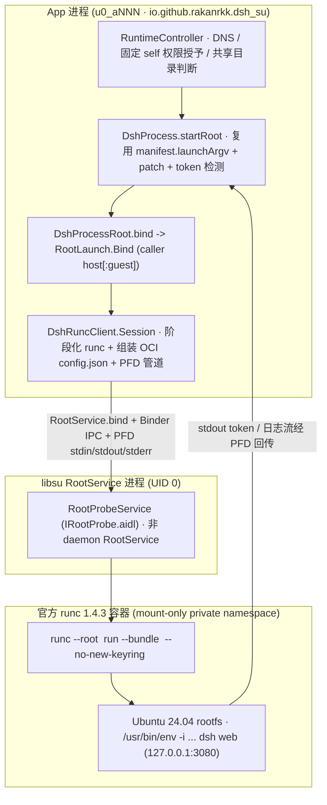

# dsh-Su root runtime 设计契约

## 范围

`dsh-Su` 让本地 runtime 中的 DSH 引擎及其全部子进程以真实 UID/GID 0 运行。App 主界面、聊天、工具、插件、HTTP/SSE 通信以及远程 SSH / DSH Remote 保持原版实现；上游 PRoot 与 Direct 启动代码保持不动，Root 专有逻辑收敛在独立模块中。

Root 构建（`BuildConfig.ROOT_RUNTIME = true`）启动失败时直接报告错误，不回退 PRoot；安全模式同样走 Root 启动，因为 PRoot 以 App UID 运行，无法读写或清理 Root 创建的文件。

## 运行架构

## 模块职责与改动边界

- **`RootProbeService`（`com.github.topjohnwu.libsu:service:6.0.0`）**：普通非 daemon `RootService`，仅作为 UID 0 进程桥与 `runc` 生命周期宿主，不重新实现 DSH。
  - `RootService` 由 `libsu` 通过 root 侧 `app_process` 动态加载并经 Binder 连接，**不是**普通 Android `<service>` 组件；`AndroidManifest.xml` 中不声明 `RootProbeService`（避免 lint 错误与无效组件暴露），混淆规则由 `libsu:service` 自带的 `consumer-rules.pro` 保持。
- **`DshRuncClient`**：
  - 构建阶段由 `tooling/build-root-apk.sh` 调用 `tooling/fetch-runc-assets.sh`，自动拉取并校验官方 `opencontainers/runc` `v1.4.3`（`amd64` / `arm64` SHA-256），打入 APK 资产 `assets/runtime/root-runtime/runc`。
  - 运行时按 SHA-256 与版本戳将 `runc` 提取至 `filesDir/runc/runc`（`0755`），生成每次会话独立的 `containerId`（`dsh-<uuid12>`）与 OCI `config.json`。
  - Root Shell 选择与绑定：优先使用 `Shell.getShell()` 默认绑定（`RootService.bind`）；当默认主 Shell 非 root 时，按 `RootCommands.suEntries` 顺序探测绝对路径 `su` 候选（如 `/debug_ramdisk/su` 等），通过 `RootService.bindOrTask` 与私有 `Shell.execTask` 启动 `RootProbeService`，并在 `release()` 时经 `Shell.EXECUTOR` 回收私有 Shell。
  - 启动期取消与 FD 门控：使用 `startGate` 互斥锁保护 `p.start` 远端提交与 `appStdin`/`started` 发布窗口；启动中若触发 `kill()`/`release()`，立即关闭待传管道 FD、释放绑定并中止后续启动，防止迟到进程在取消后拉起。
  - 创建三组 `ParcelFileDescriptor.createPipe()`（stdin / stdout / stderr）跨 Binder 传给 `RootProbeService.start(...)`，stdout 与 stderr 在 App 侧直接接回 `DshProcess` 原有的 `listener.onLog` 与 `detectToken` 流程。
- **`DshProcess.startRoot`**：
  - 完整复用原版 `manifest.launchArgv` 占位符展开、`{GUEST_ENV}` 注入、SafeMode / PhoneGuest / SessionSearchGuest / AppAuthGuest / SpeechGuest 补丁叠加，从 `/usr/bin/env` 起截取 `guestArgv`。
  - 检查 `DirectLaunch.compatibilityReason(rootfs)`：若仍存在 PRoot `.l2s` 伪硬链接存储（`prootLinkStore`），拒绝启动并报 `L2S_PRESENT`，不破坏现有链接。
- **`RootLaunch.Bind` 与 `DshProcessRoot.bind`**：
  - 轻量挂载映射器：`DshProcessRoot.bind` 将调用方传入的 `"host[:guest]"` 字符串归一化为 `RootLaunch.Bind(host, guest)`（去除末尾 `/`，省略 `guest` 时默认等于 `host`）；`RootLaunch.Bind` 仅校验 `host` 与 `guest` 均为绝对路径且不为 `/`，不内置特定挂载路径白名单。
  - 挂载策略由调用方 `RuntimeController` 控制（开启「访问手机文件」且授权就绪时传入 `PhoneStorage.binds()`，关闭时传空列表），`DshRuncClient.Session.start` 将调用方传入的全部 `RootLaunch.Bind` 写为 OCI `rbind, rprivate` 挂载。

## OCI 容器与命名空间契约

`DshRuncClient` 基于内置 OCI `1.0.2` 模板生成 `filesDir/root-runtime-lab/bundle/config.json`，并通过 `runc --root <stateRoot> run --bundle <bundle> --no-new-keyring <containerId>` 启动：

1. **仅启用 Mount Namespace（无 PID / IPC / User Namespace）**：
   - 移动设备内核普遍不开启 `CONFIG_PID_NS` / `CONFIG_USER_NS`（如一加 15 Linux 6.12 探针仅暴露 `cgroup`、`mnt`、`net`、`time`、`uts`）。
   - `linux.namespaces` 仅声明 `[{"type": "mount"}]`，`linux.rootfsPropagation` 设为 `"private"`，隔离容器内挂载且不向宿主传播。
2. **UID/GID 0 与完整 Capabilities 继承**：
   - `process.user` 设为 `{"uid": 0, "gid": 0}`，`process.cwd` 设为 `"/root"`，`process.noNewPrivileges` 设为 `false`。
   - `process` **省略 `capabilities` 字段**（而非传空对象），使 `runc` 保留 `RootService`（UID 0）当前继承的完整 capability 集合，避免因显式置空丢失 `CAP_DAC_OVERRIDE`、`CAP_CHOWN`、`CAP_NET_RAW` 等能力。
3. **基础文件系统与共享存储挂载**：

| 容器路径 | 类型 / 来源 | 挂载选项 | 说明 |
|---|---|---|---|
| `/` | `filesDir/runtime/rootfs` | `readonly: false` | 复用原版解压的 Ubuntu 24.04 rootfs |
| `/dev` | `tmpfs` | `nosuid, noexec, mode=755` | 由 `runc` 在私有 tmpfs 上自动创建标准设备节点（`null`、`zero`、`full`、`random`、`urandom`、`tty`）与标准流符号链接，不整体 bind 宿主 `/dev` |
| `/proc` | `proc` | `nosuid, noexec, nodev` | 容器内 procfs 挂载 |
| `/dev/pts` | `devpts` | `nosuid, noexec, newinstance, ptmxmode=0666, mode=0620` | 独立伪终端实例 |
| `/dev/shm` | `tmpfs` | `nosuid, noexec, nodev, mode=1777, size=16m` | 共享内存 |
| `/sys` | `sysfs` | `nosuid, noexec, nodev, ro` | 只读 sysfs |
| 调用方额外挂载（当前开启共享存储时为 `PhoneStorage.binds()`） | `bind`（消费调用方全部 `RootLaunch.Bind`） | `rbind, rprivate` | `rbind` 保留 `/storage` 下各 FUSE 子挂载可见性，`rprivate` 防止挂载传播回宿主；关闭时传空表 |

4. **DNS 与 Node.js 解析**：
   - 启动前由 `RuntimeController` 调用 `GuestSetup.writeResolvConf(app, installer.rootfs)` 写入 DNS 配置。
   - 复用原版 `manifest.launchArgv` 与 `NODE_OPTIONS` DNS 注入逻辑。

## 生命周期、停止与真实退出边界

Android 真机 `/proc` 通常挂载为 `hidepid=invisible`，普通 App UID 无法通过扫描 `/proc` 枚举或发信号给 UID 0 进程。Root 模式跳过 `RuntimeProcessOwnership`、`signalOwned` 与 `killStrays`，统一通过 `RootProbeService` + `runc` 管理生命周期：

1. **自有 cgroup 路径**：每个容器实例在 `linux.cgroupsPath` 中绑定独立标识 `containerId`（`dsh-<uuid12>`），仅管理本次容器实例，不触碰其他 UID 0 进程。
2. **正常停止（`DshProcess.stop` → `DshRuncClient.Session.kill`）**：
   - App 先关闭 `appStdin` 写端（触发 EOF），随后通过 Binder 调用 `IRootProbe.stop(containerId, stateRoot)`。
   - `RootProbeService` 执行 `runc --root <stateRoot> kill <containerId> KILL`（最多等待 10s），等待 `runc run` 主进程退出（最多 15s），再幂等执行 `runc --root <stateRoot> delete --force <containerId>`（最多 10s），返回 `"ok:<exitCode>"`。
3. **进程等待与异常退出（`awaitRemoteExit` / `waitExit`）**：
   - `dsh-runc-wait` 线程轮询 `IRootProbe.waitExit(containerId, stateRoot, 1000)`；一旦容器自行退出，`RootProbeService` 立即执行 `runc delete --force` 并返回真实退出码 `"ok:<code>"`。
   - 若 `RootService` 连接意外断开（`onServiceDisconnected`），或 `RootProbeService.onDestroy()` 触发，服务端兜底执行 `runc kill ... KILL` 与 `runc delete --force`，客户端以退出码 `-1`（`confirmed = false`）收敛状态并释放绑定。
4. **单次退出报告（`reportRootExit`）**：
   - `dsh-runc-wait` 线程与 `dsh-stop` 线程通过 `@Volatile private var rootExitReported` 互斥，确保每次会话只向 `RuntimeController` 触发一次 `listener.onExit`，不重复清理或吃掉启动失败原因。

## 权限自授予与共享存储接入

1. **启动前固定自授予（`autoGrantSelfPermissionsWithRoot`）**：
   - 在 `RuntimeController` 规划存储挂载前，Root 构建通过 `BackgroundControl.autoGrantSelfPermissionsWithRoot` 经 Root 通道执行一次固定 `OP_GRANT_SELF`（覆盖共享存储与 `WRITE_SECURE_SETTINGS` 等）。
   - **以系统实际权限状态为准**：RPC 返回值不直接作为授权成功依据，调用后必须复核 `PhoneStorage.isGranted(app)`，未获授权时记录日志且不伪造界面已开启状态。
2. **调用方受控挂载**：
   - 仅当用户在引导/设置中开启「访问手机文件」且 `PhoneStorage.isGranted(app)` 为真时，才将 `PhoneStorage.binds()` 传入 `DshProcess.startRoot`，并在 `DshRuncClient.start` 中生成 `rbind, rprivate` 挂载条目。
3. **冗余设置项隐藏**：
   - Root 构建下固定走 `runc` 容器路径，`DshProcess.startRoot` 忽略 `directEngine` / `directFailed` 覆盖项，UI 中同步隐藏不适用的 Direct 启动设置行。

## 已知限制与验证现状

| 项目 | 当前状态与说明 |
|---|---|---|
| **Android 系统命令（Binder / `cmd` / `am` / `pm`）** | 当前 OCI 模板仅挂载 Ubuntu 基础环境与可选共享存储，未将宿主 `/system`、`/apex` 或 `/dev/binder` 注入容器；Android 手机操控继续由宿主侧 App 无障碍 / 特权通道执行。 |
| **PRoot 伪硬链接迁移（`.l2s`）** | 若已有 rootfs 含 `.l2s` 文件，启动前会被 `DirectLaunch.compatibilityReason` 拦截并报 `L2S_PRESENT`，需先完成链接迁移或重置运行时。 |
| **Root 框架与架构验证范围** | **SukiSU Ultra（x86_64）**：已通过真 Root 启动、UI Stop/Start、App 进程终止恢复、原 UI PTY 终端（`shell`/`node`/`python` UID 0）、文件读写删、`getent` DNS 解析、覆盖升级保 UID/rootfs、自动权限授予系统值核验、共享存储 On 读宿主 `Download` 与 Off 自动重启移除挂载配置；**Magisk（x86_64）**：最新合并源码已通过私有 `/debug_ramdisk/su` 候选绑定、`runc` + Node UID 0 监听、通知栏 Stop 与连续启停后无迟到 Node 进程；**标准 KernelSU / KernelSU Next（x86_64）**：前期基线已通过真 Root 就绪与清理验证，正补跑当前同源码版本复核；**APatch（ARM64）**：官方完整 Android 14（kernel `6.1.172`）环境已进入 `init` 第二阶段与控制台，ADB 启动尚未完成；**ARM64 内部构建产物（`1.0.9-internal.3`）**：已完成正式签名固定、ABI、`main.jar` `RootServerMain` 引导与哈希静态校验，**尚未在 ARM64 真机上测试**。 |
| **文件属主与升级重置** | 容器以 UID 0 写入 rootfs（如 `/root`、`/tmp/dsh-web.pid`）；App 侧跳过启动前 `dsh-web.pid` 删除检查，重置与升级时需确保容器已停止且无残留挂载。 |

## 参考规范与上游组件

- [topjohnwu/libsu v6.0.0](https://github.com/topjohnwu/libsu)：`Shell` 与普通非 daemon `RootService` Binder IPC 机制。
- [opencontainers/runc v1.4.3](https://github.com/opencontainers/runc)（提交 `bb14dabeb7185bb72c8c86735d090dcb20f36587`）与 [OCI Runtime Specification v1.0.2](https://github.com/opencontainers/runtime-spec/blob/v1.0.2/config.md)：容器配置、mount namespace 传播、capability 继承与 `kill`/`delete` 生命周期。
- [Linux cgroup v2](https://docs.kernel.org/admin-guide/cgroup-v2.html) 与 [procfs mountinfo](https://www.kernel.org/doc/Documentation/filesystems/proc.txt)：容器 cgroup 归属与挂载传播语义。
- [SukiSU v4.3.0 sucompat](https://github.com/SukiSU-Ultra/SukiSU-Ultra/blob/v4.3.0/kernel/feature/sucompat.c) 与 [ksud su 参数实现](https://github.com/SukiSU-Ultra/SukiSU-Ultra/blob/v4.3.0/userspace/ksud/src/su.rs)：框架入口匹配与命令方言是两层行为。
