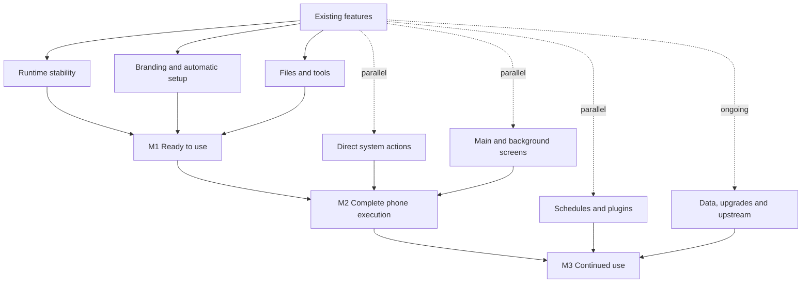

# DSH SU roadmap and progress

[简体中文](dsh-su-roadmap.md) · [Repository home](../README.en.md) · [Public releases](https://github.com/Rakanrkk/dsh-Su/releases)

Updated: 2026-11-05.

DSH SU aims to make chat, terminals, files, plugins and phone control ready to use after granting Root, while continuing to receive upstream features and fixes.

## Version status

| Version | Status |
| --- | --- |
| **1.1.0+11051253** | ARM64 and x64 APKs delivered locally; not yet uploaded to GitHub Releases |
| [v1.0.9-internal.9](https://github.com/Rakanrkk/dsh-Su/releases/tag/v1.0.9-internal.9) | Current public GitHub prerelease |

New device-use validation is incomplete for 11051253. Attachment and interface compatibility issues are being repaired. Job-interruption handling and full plugin adoption are not included in this APK.

## What 1.1.0+11051253 delivers

- **Branding and explanations:** main user-facing labels and Root environment descriptions use DSH SU in Chinese and English.
- **Automatic Root setup:** required access is prepared centrally, onboarding reads actual permission state, and accessibility recovery is connected.
- **Main-screen actions:** coordinate taps and some system keys use Root execution; page reading retains existing capabilities.
- **Files:** improved Root file reading, preview and export, with fixes to completion and error feedback.
- **Runtime:** fewer conflicts between installation, execution, stopping and cleanup, plus additional base tools.
- **Upstream updates:** new interface and behavior fixes while retaining chat, plugins, terminals and remote connections.

## Product milestones

| Milestone | User outcome | Current progress |
| --- | --- | --- |
| **M1: Root product ready to use** | Grant Root and use core features without configuring each system permission manually; install, use, stop and restart work together | Main implementation is in 11051253; compatibility fixes are in progress |
| **M2: Complete phone execution** | Perform suitable system operations directly, control the main or background screen, receive clear results and take over when needed | Main-screen Root actions are in the APK; complete background task flows are being improved |
| **M3: Automation workspace for continued use** | Schedules, phone control and Linux tools work together; upgrades retain data and upstream updates remain available | Task-state handling and plugin adoption are progressing incrementally |

## Parallel roadmap

Features can be developed in parallel and combined for milestone deliveries. Independent work for later milestones can start early.

## Feature progress

| Feature | Current state | Next |
| --- | --- | --- |
| Branding and help | Main text is in the new APK | Keep explanations aligned with behavior |
| Root runtime | Existing runtime foundation; installation-conflict fixes are in the APK | Resolve actual start, stop and recovery failures |
| Automatic access and setup | Main implementation is in the APK | Improve denied access, revocation and retries |
| Files and terminals | Improved Root file access and additional base tools | Repair ordinary and remote attachment compatibility |
| Direct Android operations | Some capabilities are available | Add suitable operations through direct execution |
| Main-screen control | Some actions now use Root | Improve feedback and user handoff |
| Background control | Existing background-screen capability | Improve automatic preparation, availability checks and complete task flows |
| Schedules and background jobs | Existing features retained; interruption state in development | Report interrupted tasks accurately and avoid duplicate execution |
| Data and upgrades | Existing update and data-preservation capabilities | Improve in-place upgrades and recovery from failures |
| Plugins | Implementation direction defined | Gradually move suitable tools, skills and panels into plugins |
| Upstream and releases | Ongoing | Resolve current compatibility issues and update the public release |

## Long-term direction

- Retain upstream features and keep Root changes small and concentrated.
- Prefer the existing plugin system for new tools, skills, task composition and panels.
- Use the current screen by default and the background screen when explicitly selected; explain unavailable background capabilities.
- Develop independent features in parallel and prioritize problems that affect actual use.
- Update this page's progress, build contents and known issues with each feature delivery or release.
