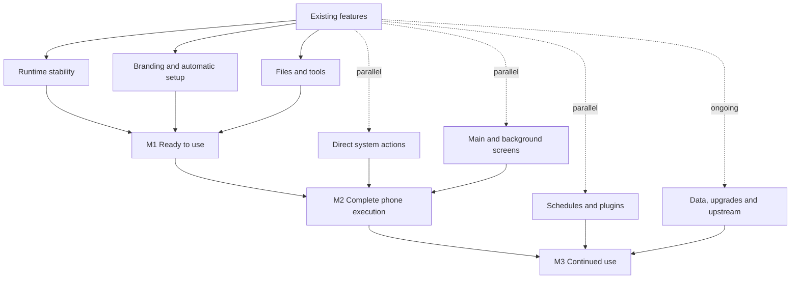

# DSH SU roadmap and progress

[简体中文](dsh-su-roadmap.md) · [Repository home](../README.en.md) · [Public releases](https://github.com/Rakanrkk/dsh-Su/releases)

Updated: 2026-11-05.

DSH SU aims to make chat, terminals, files, plugins and phone control ready to use after granting Root, while continuing to receive upstream features and fixes.

## Version status

| Version | Status |
| --- | --- |
| **1.1.0+11051721** | Latest ARM64 and x64 candidate APKs; not yet tested on a device or uploaded to GitHub Releases |
| 1.1.0+11051253 | Previous candidate APKs |
| [v1.0.9-internal.9](https://github.com/Rakanrkk/dsh-Su/releases/tag/v1.0.9-internal.9) | Current public GitHub prerelease |

11051721 includes job-interruption observation, on-demand Root background guidance and the first bundled tool-environment diagnostic plugin. These features are in the candidate APKs; device use remains unverified and M1–M3 are not complete as a whole.

## New features and fixes in 1.1.0+11051721

This build retains the previous candidate's branding, automatic Root setup, main-screen actions and file capabilities, and adds:

- **Job-interruption observation:** after the engine restarts, previously observed jobs show an interrupted state rather than continuing to appear live. Old tasks are not automatically repeated.
- **On-demand background guidance:** explains when background tasks prepare Root and shows the current notification state.
- **Tool-environment diagnostics:** a bundled plugin offers a read-only tool and panel to inspect the availability and versions of common command-line tools.
- **Compatibility fixes:** repairs ordinary and remote attachment behavior and matches permission entry points to the runtime mode.

## Product milestones

| Milestone | User outcome | Current progress |
| --- | --- | --- |
| **M1: Root product ready to use** | Grant Root and use core features without configuring each system permission manually; install, use, stop and restart work together | Core features and compatibility fixes are in candidate 11051721; device-use validation is incomplete |
| **M2: Complete phone execution** | Perform suitable system operations directly, control the main or background screen, receive clear results and take over when needed | Main-screen Root actions and on-demand background guidance are in the candidate; complete background task flows are being improved |
| **M3: Automation workspace for continued use** | Schedules, phone control and Linux tools work together; upgrades retain data and upstream updates remain available | Job-interruption observation and the first diagnostic plugin are in the candidate; ongoing tasks and upgrades are being improved |

## Parallel roadmap

Features can be developed in parallel and combined for milestone deliveries. Independent work for later milestones can start early.

## Feature progress

| Feature | Current state | Next |
| --- | --- | --- |
| Branding and help | Main text is in the new APK | Keep explanations aligned with behavior |
| Root runtime | Existing runtime foundation; installation-conflict fixes are in the APK | Resolve actual start, stop and recovery failures |
| Automatic access and setup | Main implementation is in the APK | Improve denied access, revocation and retries |
| Files and terminals | Root file access, base tools and ordinary/remote attachment fixes are in the candidate | Continue improvements from actual use |
| Direct Android operations | Some capabilities are available | Add suitable operations through direct execution |
| Main-screen control | Some actions now use Root | Improve feedback and user handoff |
| Background control | On-demand preparation guidance is in the candidate, retaining existing background-screen capabilities | Improve complete background task flows |
| Schedules and background jobs | Job-interruption observation is in the candidate | Improve ongoing tasks and avoid duplicate execution |
| Data and upgrades | Existing update and data-preservation capabilities | Improve in-place upgrades and recovery from failures |
| Plugins | The first bundled tool-environment diagnostic plugin is in the candidate | Add tools, skills and panels for actual needs |
| Upstream and releases | Candidate 11051721 has been built | Complete necessary validation before updating the public release |

## Long-term direction

- Retain upstream features and keep Root changes small and concentrated.
- Prefer the existing plugin system for new tools, skills, task composition and panels.
- Use the current screen by default and the background screen when explicitly selected; explain unavailable background capabilities.
- Develop independent features in parallel and prioritize problems that affect actual use.
- Update this page's progress, build contents and known issues with each feature delivery or release.
