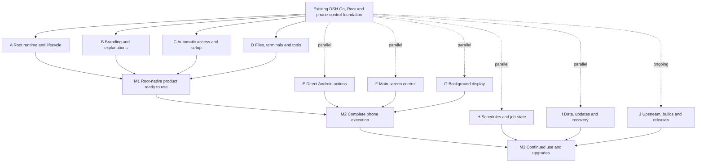

# DSH SU roadmap and progress

[简体中文](dsh-su-roadmap.md) · [Repository home](../README.en.md) · [Public releases](https://github.com/Rakanrkk/dsh-Su/releases)

Updated: 2026-11-05.

DSH SU retains upstream chat, models, sessions, plugins, files, terminals and remote connections, with Root as the execution foundation on the phone. After the user grants Root, the app prepares the permissions required by its features. Direct Android actions, the main screen and a background virtual display use the existing tool entry points.

## Current builds

| Item | Status |
| --- | --- |
| Latest locally delivered build | **1.1.0+11051253**, release-signed, arm64-v8a and x86_64 |
| APK source | [fb2b200](https://github.com/Rakanrkk/dsh-Su/commit/fb2b20054a6daf62231af181858320a586a05f41) |
| Latest public GitHub prerelease | [v1.0.9-internal.9](https://github.com/Rakanrkk/dsh-Su/releases/tag/v1.0.9-internal.9); 11051253 has not been uploaded to Releases |
| Integrated upstream baseline | [df4c9b2](https://github.com/ccch1mneyyy/dsh-Go/commit/df4c9b26017d51ac00d47104fc1c5b0c587b1410) |
| Validation scope | Build records include focused unit tests and static checks; no new device-use validation has been completed for 11051253 |
| Full CI | [The run for 39860d8](https://github.com/Rakanrkk/dsh-Su/actions/runs/41971014554) did not fully pass. Ordinary/remote attachment compatibility and branding baselines/assertions are being repaired. That commit only changes two test images after the APK source |
| Work outside the APK | M3 job-interruption changes are in development and excluded from 11051253. Guide labels were corrected in the later commit [6f8e296](https://github.com/Rakanrkk/dsh-Su/commit/6f8e2966eb9c1c67a9abd4981dc98c289e49326d) |

“In the build” identifies code included in a specific APK. Device validation and public release are tracked separately.

## What 1.1.0+11051253 contains

| Capability | Included changes |
| --- | --- |
| Branding and explanations | Main user-facing labels and Root environment descriptions use DSH SU in Chinese and English |
| Root access and onboarding | Centralized Root access preparation; install/start reads actual permission state; onboarding proceeds from that state, with accessibility recovery connected to Root |
| Main-screen control | Direct Root execution for main-screen actions; page structure still uses existing accessibility capabilities |
| File reading and export | Local Root files prefer Native resolution, reading and export; public entry points receive completion callbacks, explicit errors and asynchronous handling fixes |
| Runtime installation | Installation is refused while execution, stopping or cleanup remains active |
| Linux environment | Runtime package locks include host utilities, reusing the Ubuntu, Node, DSH and packaging pipeline |
| Upstream features | Upstream interface and behavior fixes are integrated while retaining chat, plugins, terminals and remote connections |

The Root engine retains the existing libsu RootService + runc implementation. Full plugin migration and M3 job-interruption recovery are not included in 11051253.

## Product milestones

| Milestone | User outcome | Completion conditions | Current progress |
| --- | --- | --- | --- |
| **M1: Root-native product ready to use** | Grant Root and use chat, plugins, terminals and files without configuring each system permission manually | Automatic setup and retry work; basic use, stop and restart work together | Main implementation is in 11051253; compatibility fixes are in progress and the current APK has not been validated through device use |
| **M2: Complete phone execution** | Select direct system actions, the main screen or a background display with accurate results and user handoff | Suitable actions use direct execution; screen routing is explicit and background failures never silently switch to the main screen | Main-screen Root actions are in the APK; background control reuses existing code and the complete task path still needs completion |
| **M3: An automation workspace for continued use and upgrades** | Existing schedules, jobs, phone control and Linux tools work together; updates preserve user data | Job state matches engine lifecycle; update/recovery works; commits, releases and upstream integration are maintainable | Interruption state is in development and excluded from 11051253; plugin adoption proceeds feature by feature |

## Parallel development

A–D feed M1. E–G can start early and join M1 at M2. H–J and plugin adoption run alongside development and feed M3. Arrows indicate delivery dependencies, not a requirement to serialize independent work.

## Development progress

| Track | Scope and implementation | Current state | Next delivery |
| --- | --- | --- | --- |
| A Lifecycle | Reuse RuntimeController, DshRuncClient, libsu and runc; manage owned processes and mounts | Existing implementation; install exclusion fix is in the APK | Resolve actual start, stop and cleanup failures |
| B Branding | DSH SU labels and Root explanations through existing bilingual generators | Main text is in the APK; later guide corrections are committed, with some test baselines still being repaired | Correct text-related failures and keep explanations aligned with behavior |
| C Automatic access | Reuse ensureRootAccess, grantSelf and A11yKeeper; inspect actual permission state | Main implementation is in the APK | Complete partial-failure, revoked-access and retry behavior |
| D Files and terminals | Reuse Native Root exports, GuestFiles and existing terminals; add needed base tools | Root file changes and tool locks are in the APK; ordinary/remote attachment compatibility is being repaired | Complete compatibility across ordinary, remote and Root consumers |
| E Direct system actions | Prefer system interfaces, existing privileged execution and Phone MCP | Some capabilities already exist | Add suitable direct system operations through existing tools or plugins |
| F Main screen | Retain UI-node semantics; use Root for suitable actions | Main-screen Root actions are in 11051253 | Complete error reporting and user handoff |
| G Background display | Reuse BackgroundDisplay, UiAutomation, InputManager and ImageReader | Existing Android 14+ route; complete flow not validated for this build | Improve automatic preparation and capability status without silent main-screen fallback |
| H Task integration | Reuse schedule/job/session facilities; identify engine-instance changes and interrupted jobs | In development, excluded from the APK | Deliver a small interruption-state change while keeping older hosts compatible |
| I Update and recovery | Reuse staging and preservation of user /root; retain app identity and signing continuity | Existing implementation; upgrade-use validation for 11051253 is incomplete | Repair reproducible preservation or recovery failures |
| J Upstream and releases | Standard Git integration, small patches, existing incremental build and release scripts | Upstream integrated; 11051253 remains local and GitHub still has internal.9 | Resolve current compatibility problems and update the public release |
| Plugins | DSH/Cordis plugins for tools, commands, skills, configuration and native panels | Direction defined; full adoption is not in this build | Use a currently needed small feature for the first plugin slice |

## Implementation and compatibility

- **Shared upstream layer:** reuse chat, sessions, models, plugin protocols and remote transport; concentrate Root changes on local execution.
- **Native layer:** retain initial authorization, installation, engine lifecycle, Android services, input, virtual displays and system file sharing in existing modules.
- **DSH SU plugin:** prefer one bundled plugin for new tools, skills, task composition, status and diagnostics, initially distributed with the runtime/APK.
- **Host interfaces:** ctx.dshGo handles presentation and interaction, not direct Root or phone APIs. Reuse Phone MCP for programmatic Android access where possible; add a small host interface only for a missing capability.
- **Version compatibility:** reuse engines.dsh, dshGo.v, caps and adaptView. Fork and upstream app version numbers are not equivalent; detect actual Root interfaces.
- **Phone routing:** use direct system interfaces when suitable; keep the main screen as default and select the background display explicitly. Report unavailable background capabilities without taking over the main screen.
- **Task recovery:** jobs live in engine-process memory. Report interruption after restart without automatically replaying phone actions; stored schedules and sessions retain upstream data semantics.

## Development and updates

- Work on independent modules in parallel with one owner for shared files. Use short branches, isolated worktrees when needed, and small integrations into the current development branch.
- Keep product goals and build status in this public roadmap. Internal investigation notes are not evidence that a feature has shipped.
- Update affected progress rows, build contents and remaining problems with the same set of commits that integrates a feature or publishes a release. Measure progress by delivered behavior, not test counts.
- Prefer focused unit tests and static checks, reuse build caches, and use short necessary calls to confirm system connections rather than prolonged emulator UI interaction.
- Continue local commits, pushes and releases without requiring issues or PRs. Integrate upstream locally with standard Git and remove local patches once upstream replaces them.
