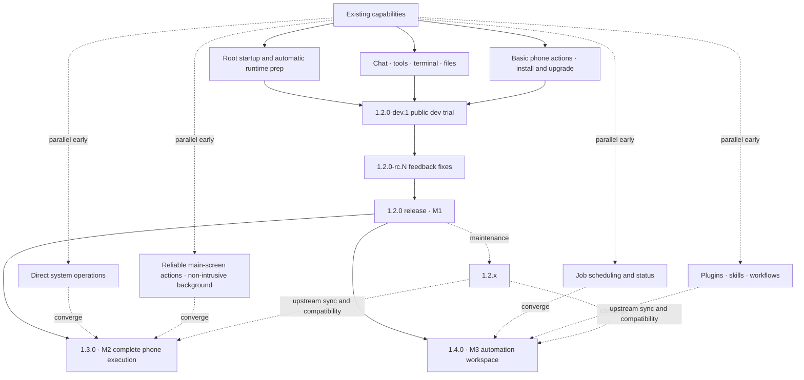

# DSH SU roadmap and progress

[简体中文](dsh-su-roadmap.md) · [Repository home](../README.en.md) · [Public releases](https://github.com/Rakanrkk/dsh-Su/releases)

Updated: 2026-11-06.

dsh-Su targets Root Android users: deliver a usable Root AI workbench first, then expand from real-world feedback. After granting Root, the app prepares the required system permissions and runtime automatically; model access uses the provider you choose, with sign-in or credentials.

## Version status

| Version | Status |
| --- | --- |
| 1.2.0-dev.1 | Target for this public development trial: ARM64 APK built, core-use validation in progress, not yet published |
| [v1.0.9-internal.9](https://github.com/Rakanrkk/dsh-Su/releases/tag/v1.0.9-internal.9) | Current public GitHub prerelease |

Actual download scope and known issues ship with each Release.

## 1.2.0-dev.1 launch scope

| Item | Description |
| --- | --- |
| Launch scope | Root startup with automatic runtime preparation; model configuration, real chat and model-invoked tools; basic terminal and file use; main-screen reading, basic actions and necessary system operations; chat history survives stop and restart, and in-place upgrades keep data |
| Delivery condition | One ordinary ARM64 build completes the full path: install or upgrade in place → grant Root → configure a model → chat plus real tool and file use → necessary phone actions → stop, reopen and read the history back |

Ship on these core paths alone; complex background execution, schedule reliability, more plugins and more ROM adaptation belong to later releases.

## Milestones

| Milestone | Goal | Status |
| --- | --- | --- |
| M1 Usable core product | Publish 1.2.0-dev.1 as a public development trial, converge feedback through 1.2.0-rc.N, release 1.2.0 | Top priority; dev.1 APK built, core-use validation in progress |
| 1.2.x maintenance | Fix real feedback, startup and upgrade issues, and compatibility; no new release-gating scope | Starts with public feedback |
| M2 Complete phone execution | Target 1.3.0: direct system operations, reliable main-screen actions, non-intrusive background execution with clear status, errors, abort and user handoff | Advanced in parallel on feature branches |
| M3 Automation workspace | Target 1.4.0: status, results, cancellation and controlled failure handling for existing schedules and long jobs; reuse plugins for tools, skills and workflows; never auto-repeat interrupted tasks | Independent parts start early without blocking M1 |

The app, engine and plugins are numbered independently.

## Parallel roadmap

Features develop in parallel and converge per milestone; independent M2 and M3 work can start early, with upstream syncing and compatibility across branches.

## Technical route

| Area | Route |
| --- | --- |
| App, UI, chat and clients | Reuse Flutter and upstream DSH |
| Root lifecycle | Reuse the existing libsu + runc native layer |
| System, main-screen and background execution | Reuse existing Root/native phone channels and extend the established execution paths |
| Tools, skills and panels | Prefer the existing DSH plugin system; Android permissions and privileged interfaces stay in the native layer |
| Jobs and status | Reuse existing scheduling, events, storage and plugin capability; thin extensions only for proven gaps |
| Compatibility and upstream syncing | Sync upstream through the existing Git flow, keep Root customization in a few modules, and reuse the plugin compatibility mechanism |

## Progress

| Item | Status |
| --- | --- |
| 1.2.0-dev.1 ARM64 ordinary APK | Built |
| Same-build model chat, tools, phone actions, stop and reopen acceptance | In progress |
| Public release preparation | In progress |
| 1.2.x feedback fixes | Starts with public feedback |
| 1.3.0 phone-execution expansion | Planned target, some groundwork exists |
| 1.4.0 jobs and plugins | Planned target, some groundwork exists |
