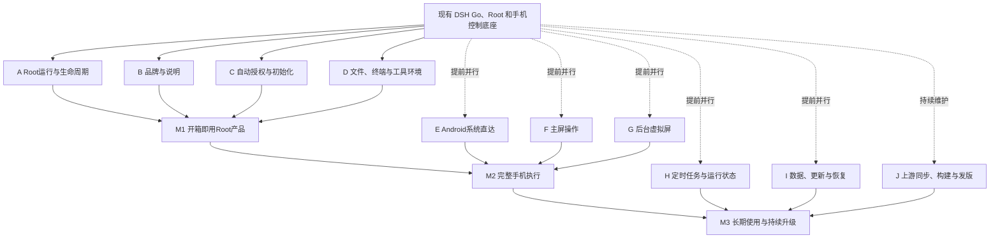

# DSH SU 开发计划与进度

[English](dsh-su-roadmap.en.md) · [项目首页](../README.md) · [公开发布](https://github.com/Rakanrkk/dsh-Su/releases)

更新日期：2026-11-05。

DSH SU 保留上游的聊天、模型、会话、插件、文件、终端与远程连接能力，以 Root 作为本机执行基础。用户授予 Root 后，由 App 配置功能所需权限；Android 系统操作、主屏操作和后台虚拟屏共用现有工具入口。

## 当前版本

| 项目 | 状态 |
| --- | --- |
| 最新已提供的本地安装包 | **1.1.0+11051253**，正式签名，arm64-v8a 与 x86_64 |
| 安装包源码 | [fb2b200](https://github.com/Rakanrkk/dsh-Su/commit/fb2b20054a6daf62231af181858320a586a05f41) |
| 最新 GitHub 公开预发布 | [v1.0.9-internal.9](https://github.com/Rakanrkk/dsh-Su/releases/tag/v1.0.9-internal.9)；11051253 尚未上传到 Releases |
| 已吸收的上游基线 | [df4c9b2](https://github.com/ccch1mneyyy/dsh-Go/commit/df4c9b26017d51ac00d47104fc1c5b0c587b1410) |
| 验证范围 | 构建记录包含定向单元测试和静态检查；11051253 尚未进行新的设备使用验证 |
| 完整 CI | [39860d8 的运行记录](https://github.com/Rakanrkk/dsh-Su/actions/runs/41971014554)未全部通过；普通/远程附件兼容及品牌基线、断言正在修复。该提交在安装包源码后只修改了两张测试图片 |
| 安装包之外的工作 | M3 任务中断状态改动处于开发中，未进入 11051253；指南标签修正在后续提交 [6f8e296](https://github.com/Rakanrkk/dsh-Su/commit/6f8e2966eb9c1c67a9abd4981dc98c289e49326d) |

“已入包”表示实现进入指定安装包；设备验证与公开发布分别记录。

## 1.1.0+11051253 包含什么

| 能力 | 本版内容 |
| --- | --- |
| 品牌与说明 | 用户可见的主要文案和 Root 环境说明统一为 DSH SU，中英文同步 |
| Root 授权与引导 | 集中准备 Root access，安装/启动前读取所需权限实际状态；引导根据真实状态继续，无障碍恢复接入 Root 路径 |
| 主屏手机操作 | 接入 Root 主屏直接执行动作；页面结构读取继续复用已有无障碍能力 |
| 文件读取与导出 | 本机 Root 文件优先经 Native 解析、读取和导出；补充公开调用入口的成功回调、错误传递及异步处理 |
| 运行时安装 | 运行、停止或清理仍在进行时拒绝重新安装，减少生命周期交叉操作 |
| Linux 环境 | runtime 软件包锁补入宿主工具；继续复用 Ubuntu、Node、DSH 与既有打包流程 |
| 上游功能 | 吸收上游界面和行为修复，保留聊天、插件、终端与远程连接 |

Root 引擎本身沿用已有的 libsu RootService + runc 实现。11051253 没有包含完整插件化迁移或 M3 任务中断恢复。

## 产品里程碑

| 里程碑 | 用户可见成果 | 完成条件 | 当前进度 |
| --- | --- | --- | --- |
| **M1：开箱即用的 Root 原生产品** | 授予 Root 后即可使用聊天、插件、终端和文件，无需逐项手配系统权限 | 自动配置和错误重试接通；基本使用、正常停止与再次启动可用 | 主要实现已进入 11051253；兼容修复进行中，当前包设备使用路径未验证 |
| **M2：完整手机执行能力** | 系统直达、主屏、后台虚拟屏按任务选择，准确显示结果并支持用户接手 | 可直接执行的系统操作不依赖点按；主/后台路径明确，后台失败不偷偷切主屏 | 主屏 Root 动作已入包；后台复用已有实现，完整任务路径仍需收敛 |
| **M3：可长期使用和升级的自动化工作台** | 既有定时任务、后台 job、手机操作和 Linux 工具协作；更新保留用户数据 | 任务状态与引擎生命周期一致；更新/恢复可用；提交、发版与上游同步稳定运行 | 任务中断状态开发中，未入 11051253；插件化按功能逐步实施 |

## 并行开发路线

A–D 汇入 M1；E–G 可提前开发，在 M1 基础上汇入 M2；H–J 与插件化贯穿开发并汇入 M3。节点连接表示交付依赖，不要求独立工作串行等待。

## 开发进度表

| 分支 | 范围与技术路线 | 当前状态 | 下一交付 |
| --- | --- | --- | --- |
| A 生命周期 | 复用 RuntimeController、DshRuncClient、libsu 与 runc，处理自有进程和挂载 | 已有实现；安装互斥修复已入包 | 收敛实际启停和清理故障 |
| B 品牌 | 统一 DSH SU 文案、Root 说明，使用现有双语生成器 | 主要文案已入包；后续指南文字已提交，部分测试基线仍在修复 | 修正文案相关失败并保持说明与行为一致 |
| C 自动授权 | 复用 ensureRootAccess、grantSelf、A11yKeeper，读取真实权限状态 | 主要实现已入包 | 收敛部分失败、撤销授权和重试体验 |
| D 文件与终端 | 复用 Native Root 导出、GuestFiles 和现有终端；按需补基础工具 | Root 文件路径和工具锁更新已入包；普通/远程附件兼容修复中 | 完成普通、远程与 Root 三条消费路径兼容 |
| E 系统直达 | 优先复用系统接口、既有特权后端和 Phone MCP | 部分已有能力 | 将适合直接执行的新增系统操作接入现有工具或插件 |
| F 主屏 | 保留控件语义，Root 执行适合直接处理的动作 | 主屏 Root 动作已入 11051253 | 收敛真实错误反馈和用户接手行为 |
| G 后台屏 | 复用 BackgroundDisplay、UiAutomation、InputManager、ImageReader | 已有 Android 14+ 后台路线；本版完整路径未验证 | 完善自动准备和能力状态；失败不自动切主屏 |
| H 任务衔接 | 复用 schedule/job/会话；识别引擎实例变化与任务中断 | 开发中，未入包 | 交付中断状态小切片；保持旧主机兼容 |
| I 更新恢复 | 复用 staging 与用户 /root 保留流程，保持应用身份和签名连续 | 已有实现；11051253 未补齐升级使用验证 | 修复有复现依据的数据保留或恢复问题 |
| J 上游与发布 | 标准 Git 整合，小补丁，现有增量构建与发布脚本 | 上游已整合；11051253 为本地包，GitHub 仍为 internal.9 | 修复当前兼容问题并更新公开版本 |
| 插件化 | DSH/Cordis 插件承载工具、命令、技能、配置和原生面板 | 设计方向确定，未作为完整功能进入本版 | 优先用正在需要的小功能完成首个插件切片 |

## 技术分层与兼容

- **上游共享层**：聊天、会话、模型、插件协议和远程传输尽量直接复用，Root 差异集中在本机。
- **原生层**：首次授权、安装与引擎启停、Android 服务、输入、虚拟屏、系统文件分享保留在既有原生模块。
- **DSH SU 插件**：新增业务工具、技能、任务组合、状态与诊断展示优先放入一个内置插件包，初期随 runtime/APK 发布。
- **宿主接口**：现有 ctx.dshGo 负责展示和交互，不直接提供 Root 或手机 API。程序化 Android 调用优先复用 Phone MCP；缺失能力才增加小接口。
- **版本兼容**：复用 engines.dsh、dshGo.v、caps 和 adaptView；fork 与上游 App 版本号不等价，Root 能力以实际接口检测为准。
- **手机路由**：系统接口能完成的优先直达；默认主屏，明确不打扰才用后台。后台不可用时说明原因，不暗中抢占主屏。
- **任务恢复**：job 属于引擎进程内状态。重启后准确显示中断，不自动重放已执行的手机动作；保存的计划与会话沿用上游数据语义。

## 开发与更新方式

- 独立模块并行开发，共享文件有单一负责人；使用短分支和需要时的独立工作树，小步合入当前开发分支。
- 一个公开计划表维护目标和版本状态；内部调查记录不作为已交付功能依据。
- 功能合入或发版时，同一批提交更新对应进度行、版本内容和剩余问题；完成状态以实际产物为准，不按测试数量计进度。
- 以受影响的简单单元测试和静态检查为主，构建复用缓存。系统连接点用必要的短调用确认，不使用长时间模拟器点按流程。
- 本地提交、推送和发版正常进行，issue/PR 不作为开发前置。上游同步在本地用标准 Git 流程整合；上游已替代的本地补丁及时删除。
