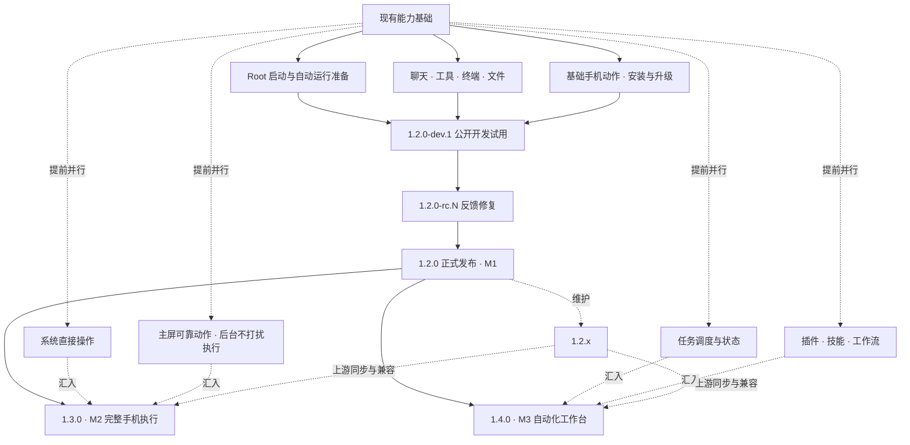

# DSH SU 开发计划与进度

[English](dsh-su-roadmap.en.md) · [项目首页](../README.md) · [公开发布](https://github.com/Rakanrkk/dsh-Su/releases)

更新日期：2026-11-06。

dsh-Su 面向 Root Android 用户：先交付能实际使用的 Root AI 工作台，再按使用反馈扩展。授予 Root 后，App 自动准备所需系统权限和运行环境；模型服务按选用的 provider 登录或填写凭据。

## 版本状态

| 版本 | 状态 |
| --- | --- |
| [`v1.2.0-dev.1`](https://github.com/Rakanrkk/dsh-Su/releases/tag/v1.2.0-dev.1) | 当前公开开发试用版：首发 **arm64-v8a**，核心可用路径已通过同包验收 |

实际下载范围与已知问题随 Release 说明给出。

## 1.2.0-dev.1 首发范围

| 项 | 说明 |
| --- | --- |
| 首发目标 | Root 启动和自动运行准备；模型配置、真实聊天和模型调用工具；终端与文件基础使用；主屏读取、基础动作和必要系统操作；停止重开保留会话，覆盖升级保留数据 |
| 交付条件 | 普通 ARM64 的同一个包完整走通：安装或覆盖升级 → 授予 Root → 配置模型 → 聊天加真实工具和文件 → 必要手机操作 → 停止重开并读回会话 |

只完成这些核心可用路径就交付；复杂后台执行、定时可靠性、更多插件和更多 ROM 适配由后续版本承担。

## 里程碑

| 里程碑 | 目标 | 状态 |
| --- | --- | --- |
| M1 可用核心产品 | 1.2.0-dev.1 公开开发试用 → 1.2.0-rc.N 收敛实际反馈 → 正式发布 1.2.0 | 本轮最高优先级；dev.1 已发布开发试用，rc 与正式发布待反馈收敛 |
| 1.2.x 维护线 | 修复真实反馈、启动和升级问题及兼容，不增加发布前置范围 | 随公开反馈启动 |
| M2 完整手机执行 | 目标 1.3.0：系统直接操作、主屏可靠动作、后台不打扰执行，状态、错误和中止明确，用户可随时接手 | 按功能分支并行推进 |
| M3 自动化工作台 | 目标 1.4.0：现有调度与长任务的状态、结果、取消和可控失败处理；复用插件增加工具、技能和工作流，不自动重复执行被中断的任务 | 独立功能提前开发，不阻塞 M1 |

应用、引擎、插件各自独立编号。

## 并行路线

各功能并行开发、阶段汇合；M2 和 M3 的独立功能可以提前推进，上游同步与兼容贯穿各分支。

## 技术路线

| 领域 | 路线 |
| --- | --- |
| App、界面、聊天与客户端 | 复用 Flutter 与上游 DSH 实现 |
| Root 生命周期 | 复用现有 libsu 加 runc 的集中原生层 |
| 系统、主屏与后台执行 | 复用既有 Root 和原生手机通道，在现有执行路径上扩展 |
| 工具、技能与面板 | 优先现有 DSH 插件体系；Android 权限与特权接口留在原生层 |
| 任务与状态 | 复用现有调度、事件、存储和插件能力，确有缺口才做薄扩展 |
| 版本兼容与上游同步 | 通过现有 Git 同步上游，将 Root 定制集中在少数模块，并复用插件兼容机制 |

## 进度

| 事项 | 状态 |
| --- | --- |
| 1.2.0-dev.1 ARM64 普通包 | 已发布 |
| 同包模型对话、工具、手机操作与停止重开验收 | 已通过 |
| 1.2.0-rc.N 反馈收敛 | 待公开反馈 |
| 1.2.x 反馈修复 | 随公开反馈启动 |
| 1.3.0 手机执行扩展 | 目标规划，部分基础已有 |
| 1.4.0 任务与插件 | 目标规划，部分基础已有 |
