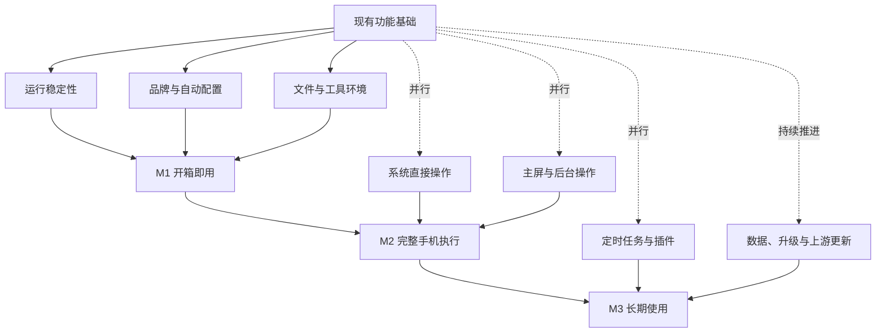

# DSH SU 开发计划与进度

[English](dsh-su-roadmap.en.md) · [项目首页](../README.md) · [公开发布](https://github.com/Rakanrkk/dsh-Su/releases)

更新日期：2026-11-05。

DSH SU 的目标是让用户授予 Root 后，就能使用聊天、终端、文件、插件和手机操作，并持续获得上游功能与修复。

## 版本状态

| 版本 | 状态 |
| --- | --- |
| **1.1.0+11051253** | 已提供本地 ARM64 和 x64 安装包，尚未上传 GitHub Releases |
| [v1.0.9-internal.9](https://github.com/Rakanrkk/dsh-Su/releases/tag/v1.0.9-internal.9) | 当前 GitHub 公开预发布版 |

11051253 尚未完成新的设备使用验证，仍有附件和界面兼容问题正在修复。任务中断处理与完整插件化未包含在这个安装包中。

## 1.1.0+11051253 完成的内容

- **品牌与说明**：主要用户界面和 Root 环境说明统一为 DSH SU，中英文同步。
- **Root 自动配置**：集中准备所需权限，根据实际授权状态完成引导，并接入无障碍自动恢复。
- **主屏操作**：坐标点击和部分系统按键接入 Root 执行，页面内容读取继续复用已有能力。
- **文件使用**：改善 Root 文件读取、预览和导出，修复操作完成与错误反馈。
- **运行环境**：减少安装与运行、停止、清理之间的冲突，并补充基础工具。
- **上游更新**：吸收新的界面和行为修复，保留聊天、插件、终端与远程连接。

## 产品里程碑

| 里程碑 | 达成后的体验 | 当前进度 |
| --- | --- | --- |
| **M1：开箱即用的 Root 产品** | 授予 Root 后即可使用核心功能，无需逐项手配系统权限；安装、使用、停止和重启顺畅 | 主要实现已进入 11051253，兼容修复进行中 |
| **M2：完整手机执行能力** | 系统操作优先直接完成，也能操作当前屏幕或后台屏；结果明确，用户可以接手 | 主屏 Root 操作已入包，完整后台任务路径继续完善 |
| **M3：可长期使用的自动化工作台** | 定时任务、手机操作和 Linux 工具协作；升级保留数据，持续获得上游更新 | 任务状态与插件化逐步推进 |

## 并行推进路线

各功能可以并行开发，阶段交付时汇合；后续阶段的独立功能可以提前推进。

## 功能进度表

| 功能 | 当前状态 | 接下来 |
| --- | --- | --- |
| 品牌与帮助说明 | 主要文案已进入新包 | 持续保持说明与实际行为一致 |
| Root 运行环境 | 已有完整运行基础，安装冲突修复已入包 | 收敛启动、停止和恢复中的实际问题 |
| 自动授权与初始化 | 主要实现已入包 | 完善授权失败、撤销和重试体验 |
| 文件与终端 | Root 文件路径已改进，基础工具已补充 | 修复普通及远程附件兼容问题 |
| Android 系统直接操作 | 部分能力可用 | 优先增加适合直接执行的操作 |
| 主屏手机操作 | 部分动作已接入 Root | 完善操作反馈与用户接手 |
| 后台手机操作 | 已有后台屏能力 | 完善自动准备、能力判断和完整任务流程 |
| 定时与后台任务 | 沿用已有功能，中断状态开发中 | 准确显示任务中断，避免重复执行 |
| 数据保留与升级 | 已有升级和数据保留能力 | 完善覆盖升级与失败恢复 |
| 插件化 | 实施方向已确定 | 将适合独立维护的工具、技能和面板逐步放入插件 |
| 上游同步与发版 | 持续推进 | 修复当前兼容问题后更新公开版本 |

## 长期方向

- 保留上游已有功能，Root 改动尽量小且集中。
- 新工具、技能、任务组合和面板优先复用插件体系。
- 默认操作当前屏幕；明确选择不打扰模式时使用后台屏，后台不可用时说明原因。
- 独立功能并行推进，优先修复影响实际使用的问题。
- 每次功能交付或版本发布，同时更新本页进度、版本内容和已知问题。
