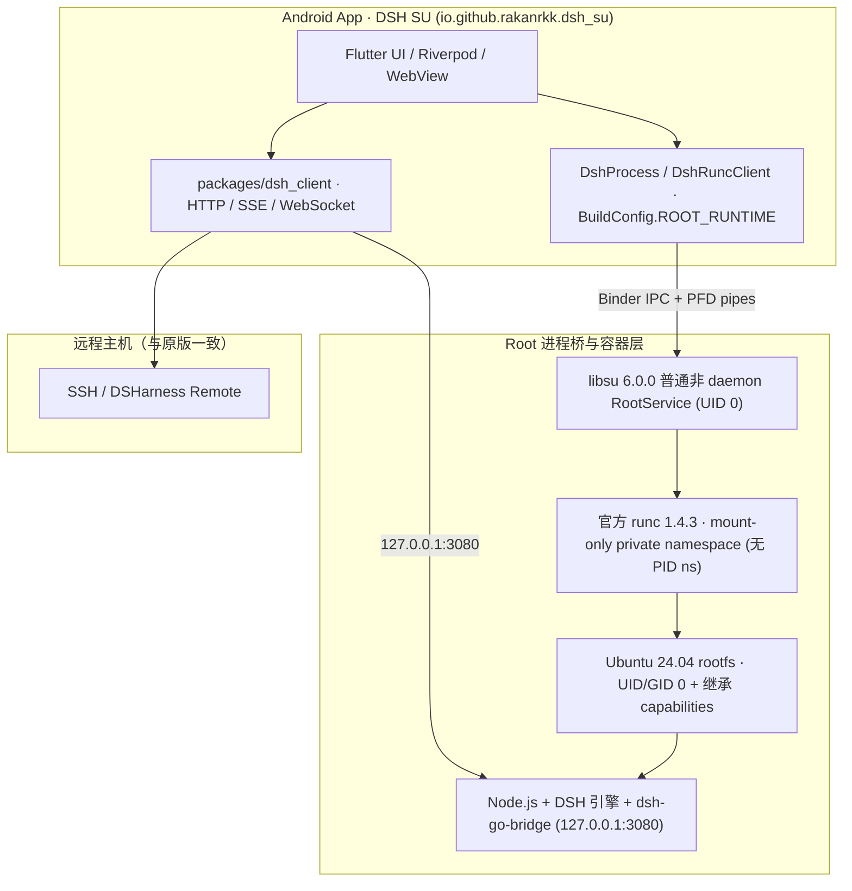

# dsh-Su 架构与开发说明

[项目首页](../README.md) · [English](../README.en.md) · [Issues](https://github.com/Rakanrkk/dsh-Su/issues) · [原版架构](architecture.md)

`dsh-Su`（仓库 [`Rakanrkk/dsh-Su`](https://github.com/Rakanrkk/dsh-Su)）面向极客、玩机者与开发者，与上游 [`ccch1mneyyy/dsh-Go`](https://github.com/ccch1mneyyy/dsh-Go) 长期平行开发。项目保留原版主界面、聊天、工具、插件、远程主机与手机操控能力，将本地运行环境切换为基于 `libsu` `RootService` 与官方 `runc` 的真实 UID 0 容器环境。

## 设计边界

- **最小上游补丁集**：Root 专有逻辑集中在独立启动与权限适配模块，直接复用原版 Ubuntu 24.04 rootfs、Node.js、打补丁的 DSH 引擎、App ↔ 引擎 HTTP 桥（`/dsh-go/v1/*`）、参数拼装、token 就绪检测、日志流及 Flutter 客户端，不重新实现 DSH，也不另造独立插件协议。
- **RootService 进程桥 + 官方 runc**：通过 `com.github.topjohnwu.libsu` `6.0.0` 普通非 daemon `RootService`（`RootProbeService`，由 `libsu` 动态加载、无需在 `AndroidManifest.xml` 中注册普通 `<service>`）提供 UID 0 进程桥与 `ParcelFileDescriptor` 标准流管道，调用官方 `opencontainers/runc` `1.4.3` 启动和回收容器。详细的 OCI 配置与生命周期契约见 [docs/design/root-runtime.md](design/root-runtime.md)。
- **Mount-only 私有命名空间与完整 Capabilities 继承**：容器仅开启独立 `mount` namespace（`rootfsPropagation: "private"`），不启用 PID namespace；进程以 `UID/GID 0` 运行并省略 OCI `capabilities` 字段以完整继承 `RootService` 的 capabilities。`DshProcessRoot.bind` 将调用方传入的任意 `"host[:guest]"` 归一化为 `RootLaunch.Bind`（仅做绝对路径与非 `/` 校验），开启共享存储时由调用方传入 `PhoneStorage.binds()`（关闭时传空表），交由 `runc` 以 `rbind` + `rprivate` 挂载。
- **应用身份与更新隔离**：开启 `dsh.rootRuntime=true` 时，Android 包名为 `io.github.rakanrkk.dsh_su`，桌面名称为 `DSH SU`，生成 `BuildConfig.ROOT_RUNTIME = true`，可与原版 `io.github.ccch1mneyyy.dsh_app` 并存安装；更新源固定为 `Rakanrkk/dsh-Su`，清空上游公共镜像、更新流与内测通道令牌。
- **明确失败，不静默回退**：Root 构建在未获 Root 授权或容器启动失败时直接报告错误，不退回 PRoot。

## 运行架构



| 项目 | 上游 DSH Go（默认构建） | dsh-Su（Root 构建） |
| --- | --- | --- |
| Android 包名 | `io.github.ccch1mneyyy.dsh_app` | `io.github.rakanrkk.dsh_su` |
| 桌面名称 | `DSH Go` | `DSH SU` |
| 构建开关 | `BuildConfig.ROOT_RUNTIME = false` | `BuildConfig.ROOT_RUNTIME = true` |
| 构建入口 | `tooling/build-apk.sh` | `tooling/build-root-apk.sh`（自动拉取并校验官方 `runc` 1.4.3） |
| 更新仓库 | `ccch1mneyyy/dsh-go` | `Rakanrkk/dsh-Su`（清空公共 mirror / feed） |
| 本地执行方式 | PRoot（App UID） | `libsu` 6.0.0 非 daemon `RootService` + 官方 `runc` 1.4.3（mount-only private ns，UID/GID 0） |

## 兼容目标与当前验证状态

当前尚未发布稳定内测包或正式 Release 产物，各模块与 Root 框架处于分步验证阶段：

### Root 框架兼容状态

| Root 框架 | 当前状态 | 已验证范围与进展 |
| --- | --- | --- |
| **SukiSU Ultra（x86_64）** | 主链路与交互已验证 | 已通过完整真 Root 启动（`127.0.0.1:3080`）、UI Stop/Start、App 进程终止恢复、原 UI PTY 终端（`shell`/`node`/`python` UID 0）、文件读写删与 `getent` DNS 解析；覆盖升级保留 UID/rootfs、自动权限授予系统状态核验、共享存储开启时读取宿主 `Download` 及关闭后自动重启移除挂载配置均已通过。 |
| **Magisk（x86_64）** | 主链路与启停已验证 | 最新合并源码下已验证私有候选 `su`（`/debug_ramdisk/su` + `RootService.bindOrTask`）选中、`runc` + Node UID 0 监听（`127.0.0.1:3080`）、通知栏 Stop 与多轮启停后无迟到 Node 进程。 |
| **KernelSU（标准版）/ KernelSU Next（x86_64）** | 基线已过 / 同源复核中 | 前期基线已完成真 Root 引擎就绪（`DSH is listening`）、App 进程终止重启恢复与清理验证，正基于最新合并源码补跑同版本复核。 |
| **APatch（ARM64）** | 镜像引导中 | 官方完整 Android 14（kernel `6.1.172`）配套环境已进入 `init` 第二阶段与控制台输出，尚未完成 ADB 就绪与 App 验证。 |

### 功能模块进展

| 模块 | 状态 | 说明 |
| --- | --- | --- |
| 构建入口与 ARM64 内部包 | 已生成待真机验证 | `tooling/build-root-apk.sh`、`tooling/fetch-runc-assets.sh`（校验官方 `runc` 1.4.3 双 ABI SHA-256）、包名 `io.github.rakanrkk.dsh_su`、桌面名称 `DSH SU` 与更新源隔离已就绪；ARM64 内部测试包（`1.0.9-internal.3`，`r15` rootfs）已完成签名固定、ABI、`main.jar` `RootServerMain` 引导与哈希静态校验，**尚未在 ARM64 真机上实测**。 |
| `RootService` + `runc` 启动链 | x86_64 已验证 | `DshRuncClient` 与 `RootProbeService` 已支持默认绑定与私有 `su` 候选 `bindOrTask` 回退、启动期取消 FD 门控、PFD 标准流转发及 `runc kill/delete` 退出回收。 |
| 权限自授予与共享存储挂载 | x86_64 已验证 | Root 通道自动权限授予（核验系统实际权限值）以及共享存储开启时 `rbind` + `rprivate` 读取宿主 `Download`、关闭时自动重启并移除挂载配置已在 x86_64 验证通过。 |

## 构建与验证命令

```bash
# 加载 Linux 开发环境
source tooling/env.sh
bash tooling/check-dev-env.sh

# 验证 Root 构建参数与更新源隔离
bash tooling/test_build_root_apk.sh

# 预览 Root APK 构建参数（--dry-run 不触发 runc 下载与编译）
bash tooling/build-root-apk.sh --dry-run -f arm64

# 拉取官方 runc 1.4.3 资产并构建 dsh-Su APK（需先准备对应架构的 runtime/out/<abi>）
bash tooling/build-root-apk.sh -f arm64 --keep-daemon
```

## 许可证与上游归属

- 源码采用 [AGPL-3.0](../LICENSE) 发布，`sdk/` 与 `examples/` 为 MIT；第三方组件声明见 [THIRD_PARTY_NOTICES.md](../THIRD_PARTY_NOTICES.md)。
- 上游项目为 [ccch1mneyyy/dsh-Go](https://github.com/ccch1mneyyy/dsh-Go)，底层智能体引擎为 [DeepSeek Harness](https://github.com/deepseek-ai/deepseek-harness)。
- Root 进程桥使用 [topjohnwu/libsu](https://github.com/topjohnwu/libsu)（Apache-2.0），OCI 容器运行时使用 [opencontainers/runc](https://github.com/opencontainers/runc)（Apache-2.0）。
- `DSH Go` 名称、品牌标识及 Deepy、鲸娘等美术素材归原作者所有，不在 AGPL-3.0 授权范围内，详见 [ASSETS.md](../ASSETS.md)。
