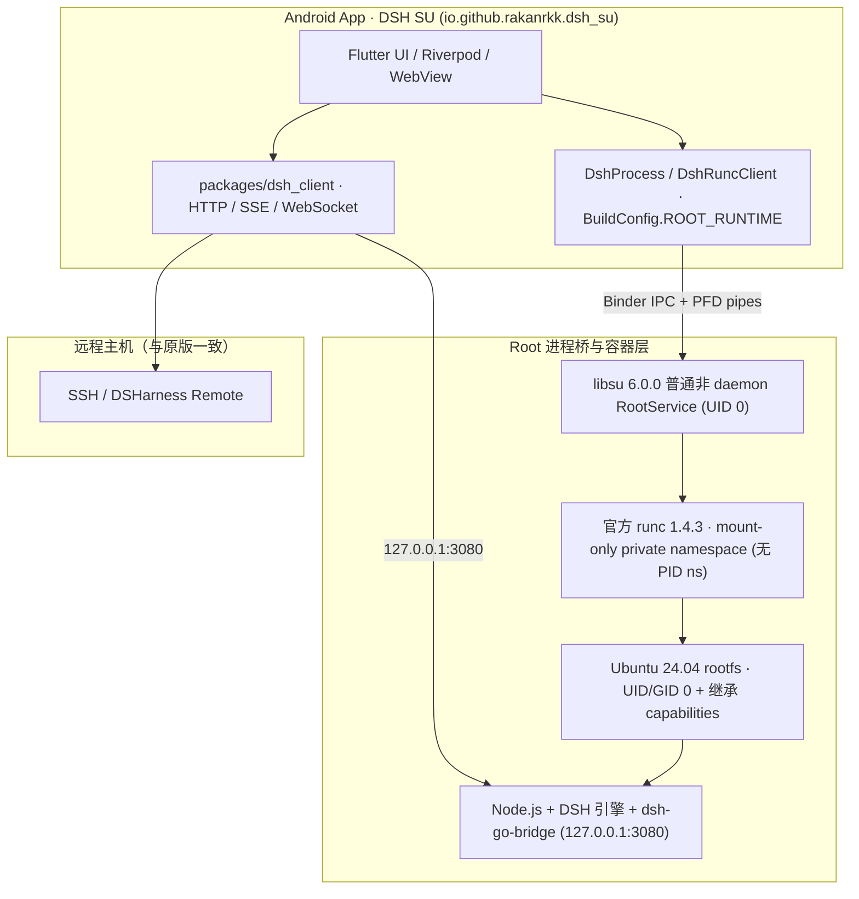

# dsh-Su 架构与开发说明

[项目首页](../README.md) · [English](../README.en.md) · [Issues](https://github.com/Rakanrkk/dsh-Su/issues) · [原版架构](architecture.md)

`dsh-Su`（仓库 [`Rakanrkk/dsh-Su`](https://github.com/Rakanrkk/dsh-Su)）面向极客、玩机者与开发者，与上游 [`ccch1mneyyy/dsh-Go`](https://github.com/ccch1mneyyy/dsh-Go) 长期平行开发。项目保留原版主界面、聊天、工具、插件、远程主机与手机操控能力，将本地运行环境切换为基于 `libsu` `RootService` 与官方 `runc` 的真实 UID 0 容器环境。

## 设计边界

- **最小上游补丁集**：Root 专有逻辑集中在独立启动与权限适配模块，直接复用原版 Ubuntu 24.04 rootfs、Node.js、打补丁的 DSH 引擎、App ↔ 引擎 HTTP 桥（`/dsh-go/v1/*`）、参数拼装、token 就绪检测、日志流及 Flutter 客户端，不重新实现 DSH，也不另造独立插件协议。
- **RootService 进程桥 + 官方 runc**：通过 `com.github.topjohnwu.libsu` `6.0.0` 普通非 daemon `RootService`（`RootProbeService`，由 `libsu` 动态加载、无需在 `AndroidManifest.xml` 中注册普通 `<service>`）提供 UID 0 进程桥与 `ParcelFileDescriptor` 标准流管道，调用官方 `opencontainers/runc` `1.4.3` 启动和回收容器。详细的 OCI 配置与生命周期契约见 [docs/design/root-runtime.md](design/root-runtime.md)。
- **Mount-only 私有命名空间与完整 Capabilities 继承**：容器仅开启独立 `mount` namespace（`rootfsPropagation: "private"`），不启用 PID namespace；进程以 `UID/GID 0` 运行并省略 OCI `capabilities` 字段以完整继承 `RootService` 的 capabilities。`DshProcessRoot.bind` 将调用方传入的任意 `"host[:guest]"` 归一化为 `RootLaunch.Bind`（仅做绝对路径与非 `/` 校验），开启共享存储时由调用方传入 `PhoneStorage.binds()`（关闭时传空表），交由 `runc` 以 `rbind` + `rprivate` 挂载。
- **应用身份与更新隔离**：开启 `dsh.rootRuntime=true` 时，Android 包名为 `io.github.rakanrkk.dsh_su`，桌面名称为 `DSH SU`，生成 `BuildConfig.ROOT_RUNTIME = true`，可与原版 `io.github.ccch1mneyyy.dsh_app` 并存安装；更新源固定为 `Rakanrkk/dsh-Su`，清空上游公共镜像、更新流与内测通道令牌。
- **明确失败，不静默回退**：Root 构建在未获 Root 授权或容器启动失败时直接报告错误，不退回 PRoot。

## 运行架构



| 项目 | 上游 DSH Go（默认构建） | dsh-Su（Root 构建） |
| --- | --- | --- |
| Android 包名 | `io.github.ccch1mneyyy.dsh_app` | `io.github.rakanrkk.dsh_su` |
| 桌面名称 | `DSH Go` | `DSH SU` |
| 构建开关 | `BuildConfig.ROOT_RUNTIME = false` | `BuildConfig.ROOT_RUNTIME = true` |
| 构建入口 | `tooling/build-apk.sh` | `tooling/build-root-apk.sh`（自动拉取并校验官方 `runc` 1.4.3） |
| 更新仓库 | `ccch1mneyyy/dsh-go` | `Rakanrkk/dsh-Su`（清空公共 mirror / feed） |
| 本地执行方式 | PRoot（App UID） | `libsu` 6.0.0 非 daemon `RootService` + 官方 `runc` 1.4.3（mount-only private ns，UID/GID 0） |

## 兼容目标与当前验证状态

SukiSU Ultra、KernelSU、Magisk、KernelSU Next 与 APatch 均为 `dsh-Su` 的兼容目标；实际验证结论按具体版本、ABI 与构建分开记录，不将单一框架或旧构建的结果外推为全框架兼容。当前唯一公开预发布版为 [`v1.0.9-internal.6`](https://github.com/Rakanrkk/dsh-Su/releases/tag/v1.0.9-internal.6)（源码提交 `f5632ddae46d8b8bdc35f16e6f041aef712fb0cb`，`versionCode` `11031064`），Release 同时提供 `x86_64`（内置 runtime `r12`）与 `arm64-v8a`（内置 runtime `r15`）正式签名 APK、`public-metadata-x86_64.json`、`public-metadata-arm64-v8a.json` 及对应 `.apk.sha256` 校验文件。

### Root 框架兼容状态

| Root 框架 | 适用版本与环境 | 已验证范围与当前边界 |
| --- | --- | --- |
| **SukiSU Ultra（x86_64 Release）** | `v1.0.9-internal.6` · Android 16（API 36）· APK SHA-256 `59e19d6686f1dea33fadda956ec31dab23ce7d859f9f8f97f112783d25667338` | 全新安装并在 SukiSU Ultra `41100-6` 开启 `DSH SU` 的 Superuser Default 后，首次引导即便拒绝系统通知弹窗，引擎启动后仍完成 RootReady（`RootService`、`runc` 与 Node 均为 UID 0，监听 `127.0.0.1:3080`）、无障碍服务自动恢复与五项平台状态回读（未知来源安装、电池优化豁免、`WRITE_SECURE_SETTINGS`、`POST_NOTIFICATIONS`、`RECORD_AUDIO`）。Phone MCP 列出 13 项工具，`apps` 与 `screen` 语义返回通过；UID 0 PTY、Node `crypto`、`/system/bin/getprop`、`cmd package path`、`pm path`、DNS 解析与 HTTPS 200、root-owned `0600` 10 字节文本预览，以及 UI 正常 Stop/Start 与停止后 30 秒稳定性检查均通过。16 字节二进制文件仅在容器内读取并计算哈希，Files 显示 `Not a text file`，未验收 Files 二进制读回、`Open` / `Open with` 与 `Share`；内置 `r12` 不含后续 Files 符号链接修复。 |
| **APatch（arm64-v8a Release）** | `v1.0.9-internal.6` · Android 14（API 34 Cuttlefish）· APK SHA-256 `e8329dfbba5e1de9c13e91b7de53cddc3a4550f7628219f6ff35d948ef6bad11` | 在 APatch `11282`（KernelPatch `0.13.9`）授权 App UID 后，普通界面 Retry 进入 RootReady（UID 0 `RootService` / `runc` / Node，监听 `127.0.0.1:3080`）；Phone MCP `apps`（15 个已知包）与 `screen`（10 个设置页节点）语义返回、UID 0 PTY、Node `crypto`、DNS 与 HTTPS 200，以及共享存储文本/二进制读写哈希一致性均通过。将 APatch Manager 的 Legacy `su` compatibility 切为 Off 后，冷启动 RootReady、五项平台状态回读为 true 及 UI Stop 后 30 秒无残留检查通过；原生 Files 预览尚未验收。 |
| **SukiSU Ultra（arm64-v8a Release）** | `v1.0.9-internal.6` · Android 14（API 34 Cuttlefish）· APK SHA-256 `e8329dfbba5e1de9c13e91b7de53cddc3a4550f7628219f6ff35d948ef6bad11` | 在 SukiSU Ultra `v4.3.0`（`41100-6`）`android14-6.1` LKM 环境将 App UID 设为永久 Superuser Default（关闭 Temporary Root）后，经 `/system/bin/su` 进入 RootReady（UID 0 `runc` / Node 与独立 `dsh-*` cgroup）；五项平台状态经 root 诊断读回为 true（普通 helper 调用 `canRequestPackageInstalls` 曾因调用身份抛 `SecurityException`），首轮曾验证通知栏 `STOP` 回收。当前产品端 Node 的 DNS/HTTPS、PTY、Phone MCP、共享存储及最终 UI Stop 回收仍在进行。 |
| **KernelSU / Magisk / KernelSU Next（历史记录）** | `v1.0.9-internal.4` 同代 x86_64 模拟器构建（非 `internal.6` APK） | KernelSU `3.3.1`（`32680`，UAPI 5，LKM，SELinux Enforcing，x86_64 debug）、Magisk（x86_64 debug）与 KernelSU Next（x86_64 release）在 `internal.4` 同代构建上曾通过 UID 0 主链、13 项 Phone MCP 工具列表、Android 宿主视图、DNS/HTTPS 与 Stop 回收；这些记录仅代表对应历史构建，`v1.0.9-internal.6` 在上述三个框架上的全新安装验收尚未归档。 |
| **启动兼容性开发验证** | 下一预发布构建待验收 | APatch 官方 `apd` 支持 `-c`；API 34 模拟器中实际 `su` 分发到启动入口时的参数差异仍待确认。无参 `su` + stdin bootstrap 修复已通过 Native 120 suites / 894 tests，新预发布包尚待全新安装验收。Android 17（API 37）模拟器在宿主 QEMU 启动阶段异常退出，兼容验证未完成。 |

### 功能模块进展

| 模块 | 状态 | 说明 |
| --- | --- | --- |
| 公开预发布制品（`v1.0.9-internal.6`） | 双架构已发布 | [Release `v1.0.9-internal.6`](https://github.com/Rakanrkk/dsh-Su/releases/tag/v1.0.9-internal.6) 提供 `x86_64` APK（SHA-256 `59e19d6686f1dea33fadda956ec31dab23ce7d859f9f8f97f112783d25667338`，内置 `r12`）与 `arm64-v8a` APK（SHA-256 `e8329dfbba5e1de9c13e91b7de53cddc3a4550f7628219f6ff35d948ef6bad11`，内置 `r15`），签名证书 SHA-256 均为 `d50d7e0ee50acd5f012829a8d7e7d187402facfb770ebb0e7f04754b6fb64dc4`，附 `public-metadata-*.json` 与 `.apk.sha256`。 |
| `RootService` + `runc` 启动链 | `internal.6` 已在 SukiSU（x64/ARM64）与 APatch（ARM64）验证 | `DshRuncClient` 与 `RootProbeService` 支持默认绑定与 `su` 候选回退、启动期取消 FD 门控、PFD 标准流转发及 `runc kill/delete` 退出回收。 |
| 权限、文件与手机工具 | 按模块推进 | 五项平台状态回读已在 `internal.6` 的 SukiSU Ultra x86_64、APatch ARM64 与 SukiSU Ultra ARM64 验证。10 字节文本预览及 APatch 共享存储读写哈希一致已通过；二进制 Files 读回/`Open`/`Share` 与符号链接跟随尚未验收。x86_64 的 13 项工具列表、`apps` / `screen` 与 `handoff` Stop 收尾已验证，最终 normal runtime Stop 验收仍在进行。 |

## 构建与验证命令

```bash
# 加载 Linux 开发环境
source tooling/env.sh
bash tooling/check-dev-env.sh

# 验证 Root 构建参数与更新源隔离
bash tooling/test_build_root_apk.sh

# 预览 Root APK 构建参数（--dry-run 不触发 runc 下载与编译）
bash tooling/build-root-apk.sh --dry-run -f arm64

# 拉取官方 runc 1.4.3 资产并构建 dsh-Su APK（需先准备对应架构的 runtime/out/<abi>）
bash tooling/build-root-apk.sh -f arm64 --keep-daemon
```

## 许可证与上游归属

- 源码采用 [AGPL-3.0](../LICENSE) 发布，`sdk/` 与 `examples/` 为 MIT；第三方组件声明见 [THIRD_PARTY_NOTICES.md](../THIRD_PARTY_NOTICES.md)。
- 上游项目为 [ccch1mneyyy/dsh-Go](https://github.com/ccch1mneyyy/dsh-Go)，底层智能体引擎为 [DeepSeek Harness](https://github.com/deepseek-ai/deepseek-harness)。
- Root 进程桥使用 [topjohnwu/libsu](https://github.com/topjohnwu/libsu)（Apache-2.0），OCI 容器运行时使用 [opencontainers/runc](https://github.com/opencontainers/runc)（Apache-2.0）。
- `DSH Go` 名称、品牌标识及 Deepy、鲸娘等美术素材归原作者所有，不在 AGPL-3.0 授权范围内，详见 [ASSETS.md](../ASSETS.md)。
