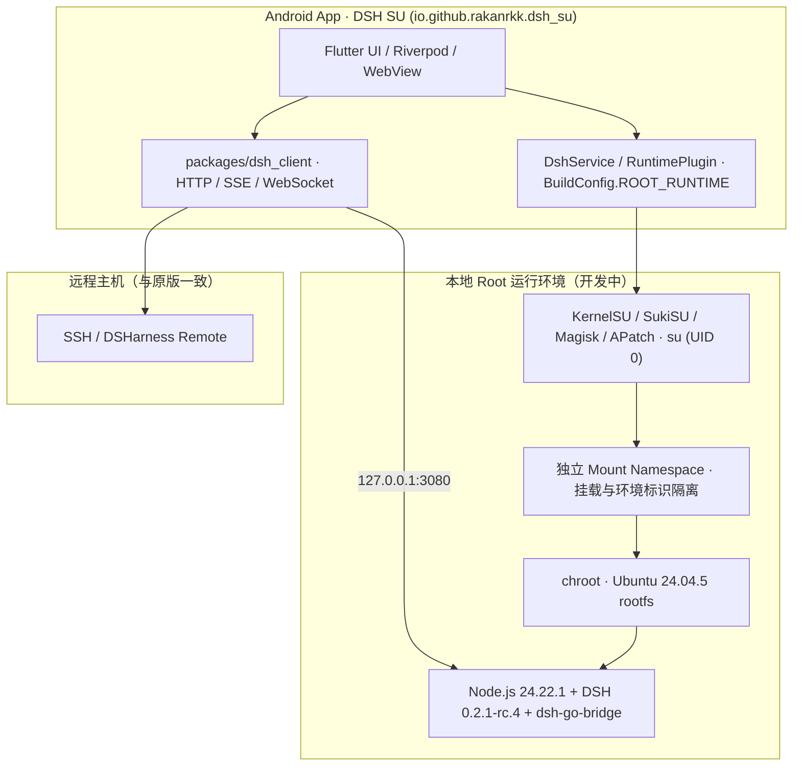

# dsh-Su 架构与开发说明

[项目首页](../README.md) · [English](../README.en.md) · [Issues](https://github.com/Rakanrkk/dsh-Su/issues) · [原版架构](architecture.md)

`dsh-Su`（仓库 [`Rakanrkk/dsh-Su`](https://github.com/Rakanrkk/dsh-Su)）面向极客、玩机者与开发者，与上游 [`ccch1mneyyy/dsh-Go`](https://github.com/ccch1mneyyy/dsh-Go) 长期并行开发。项目保留原版 Flutter 界面、远程主机、插件协议、文件与手机操控能力，将本地运行环境从 PRoot 调整为真实 UID 0（Root）`chroot` 环境。

## 设计边界

- **只改本地运行底座**：复用原版 Ubuntu 24.04 rootfs、Node.js、打补丁的 DSH 引擎、App ↔ 引擎 HTTP 桥（`/dsh-go/v1/*`）和 Flutter 客户端，不新增独立 `shell` 工具、终端权限分档或另一套插件协议。
- **应用身份与更新隔离**：开启 `dsh.rootRuntime=true` 时，Android 包名切换为 `io.github.rakanrkk.dsh_su`，桌面名称为 `DSH SU`，生成 `BuildConfig.ROOT_RUNTIME = true`。应用可与原版 `io.github.ccch1mneyyy.dsh_app` 并存安装；更新源固定为 `Rakanrkk/dsh-Su`，清空上游公共更新流、镜像与内测通道令牌。
- **明确失败，不静默降级**：Root 构建在 `su`、`chroot` 或挂载失败时直接返回明确错误码与诊断日志，不退回普通权限或 PRoot。

## 运行架构



| 项目 | 上游 DSH Go（默认构建） | dsh-Su（Root 构建） |
| --- | --- | --- |
| Android 包名 | `io.github.ccch1mneyyy.dsh_app` | `io.github.rakanrkk.dsh_su` |
| 桌面名称 | `DSH Go` | `DSH SU` |
| 构建开关 | `BuildConfig.ROOT_RUNTIME = false` | `BuildConfig.ROOT_RUNTIME = true` |
| 构建入口 | `tooling/build-apk.sh` | `tooling/build-root-apk.sh` |
| 更新仓库 | `ccch1mneyyy/dsh-go` | `Rakanrkk/dsh-Su`（清空公共 mirror / feed） |
| 本地执行方式 | PRoot（App UID） | `su` + 独立 mount namespace + `chroot`（真实 UID 0，集成中） |

## 当前状态

| 模块 | 状态 | 说明 |
| --- | --- | --- |
| 构建入口与包名隔离 | 已完成 | `tooling/build-root-apk.sh`、`io.github.rakanrkk.dsh_su`、桌面名称 `DSH SU`、`BuildConfig.ROOT_RUNTIME` 与更新源隔离已就绪。 |
| 运行时底座 | 已完成 | 复用上游 Ubuntu `24.04.5`、Node `24.22.1`、DSH `0.2.1-rc.4` 运行时产物。 |
| `chroot` 基础运行 | 已验证 | 已验证 `su + chroot` 下 `id` 与 Node 进程返回真实 UID 0。 |
| Root 引擎后端与生命周期 | 开发中 | `DshProcess.kt` 的启动协议、独立 mount namespace 挂载与卸载顺序、进程归属识别（原版依赖 App UID）、停止清理、文件属主与 `GuestSetup` 尚未合入。 |

## 构建与验证命令

```bash
# 加载 WSL / Linux 开发环境
source tooling/env.sh
bash tooling/check-dev-env.sh

# 验证 Root 构建参数与更新源隔离
bash tooling/test_build_root_apk.sh

# 预览 Root APK 构建参数（不实际编译）
bash tooling/build-root-apk.sh --dry-run -f arm64

# 构建 dsh-Su APK（需先准备对应架构的 runtime/out/<abi>）
bash tooling/build-root-apk.sh -f arm64 --keep-daemon

# 使用 emu.sh 操作 dsh-Su 安装包
DSH_SERIAL=<serial> DSH_PACKAGE=io.github.rakanrkk.dsh_su bash tooling/emu.sh launch
```

## 许可证与上游归属

- 源码采用 [AGPL-3.0](../LICENSE) 发布，`sdk/` 与 `examples/` 为 MIT；第三方组件声明见 [THIRD_PARTY_NOTICES.md](../THIRD_PARTY_NOTICES.md)。
- 上游项目为 [ccch1mneyyy/dsh-Go](https://github.com/ccch1mneyyy/dsh-Go)，底层智能体引擎为 [DeepSeek Harness](https://github.com/deepseek-ai/deepseek-harness)。
- `DSH Go` 名称、品牌标识及 Deepy、鲸娘等美术素材归原作者所有，不在 AGPL-3.0 授权范围内，详见 [ASSETS.md](../ASSETS.md)。
