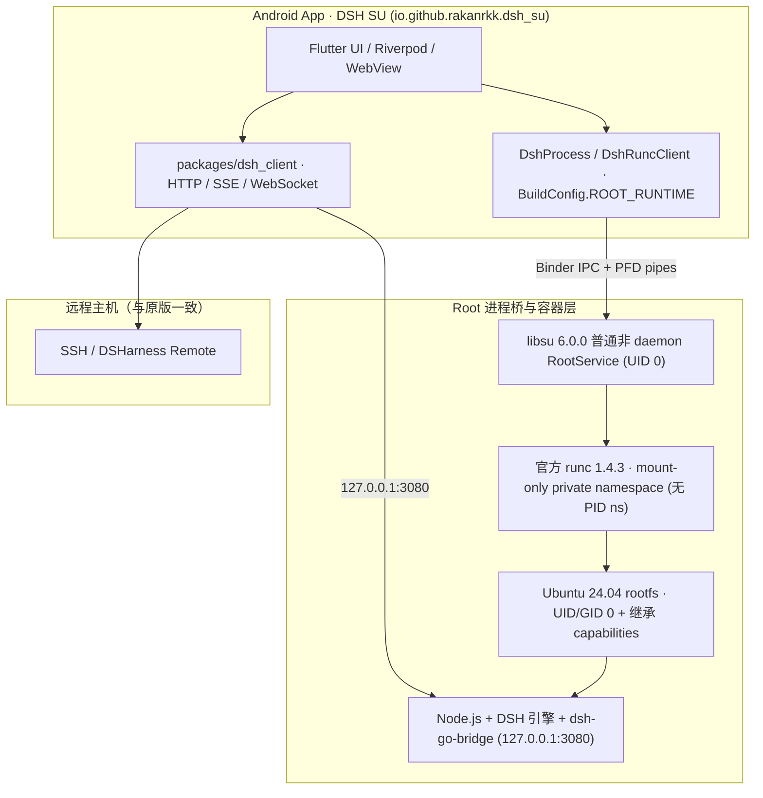

# dsh-Su 架构与开发说明

[项目首页](../README.md) · [English](../README.en.md) · [Issues](https://github.com/Rakanrkk/dsh-Su/issues) · [原版架构](architecture.md)

`dsh-Su`（仓库 [`Rakanrkk/dsh-Su`](https://github.com/Rakanrkk/dsh-Su)）面向极客、玩机者与开发者，与上游 [`ccch1mneyyy/dsh-Go`](https://github.com/ccch1mneyyy/dsh-Go) 长期平行开发。项目保留原版主界面、聊天、工具、插件、远程主机与手机操控能力，将本地运行环境切换为基于 `libsu` `RootService` 与官方 `runc` 的真实 UID 0 容器环境。

## 设计边界

- **最小上游补丁集**：Root 专有逻辑集中在独立启动与权限适配模块，直接复用原版 Ubuntu 24.04 rootfs、Node.js、打补丁的 DSH 引擎、App ↔ 引擎 HTTP 桥（`/dsh-go/v1/*`）、参数拼装、token 就绪检测、日志流及 Flutter 客户端，不重新实现 DSH，也不另造独立插件协议。
- **RootService 进程桥 + 官方 runc**：通过 `com.github.topjohnwu.libsu` `6.0.0` 普通非 daemon `RootService`（`RootProbeService`，由 `libsu` 动态加载、无需在 `AndroidManifest.xml` 中注册普通 `<service>`）提供 UID 0 进程桥与 `ParcelFileDescriptor` 标准流管道，调用官方 `opencontainers/runc` `1.4.3` 启动和回收容器。详细的 OCI 配置与生命周期契约见 [docs/design/root-runtime.md](design/root-runtime.md)。
- **Mount-only 私有命名空间与完整 Capabilities 继承**：容器仅开启独立 `mount` namespace（`rootfsPropagation: "private"`），不启用 PID namespace；进程以 `UID/GID 0` 运行并省略 OCI `capabilities` 字段以完整继承 `RootService` 的 capabilities。`DshProcessRoot.bind` 将调用方传入的任意 `"host[:guest]"` 归一化为 `RootLaunch.Bind`（仅做绝对路径与非 `/` 校验），开启共享存储时由调用方传入 `PhoneStorage.binds()`（关闭时传空表），交由 `runc` 以 `rbind` + `rprivate` 挂载。
- **应用身份与更新隔离**：开启 `dsh.rootRuntime=true` 时，Android 包名为 `io.github.rakanrkk.dsh_su`，桌面名称为 `DSH SU`，生成 `BuildConfig.ROOT_RUNTIME = true`，可与原版 `io.github.ccch1mneyyy.dsh_app` 并存安装；更新源固定为 `Rakanrkk/dsh-Su`，清空上游公共镜像、更新流与内测通道令牌。
- **明确失败，不静默回退**：Root 构建在未获 Root 授权或容器启动失败时直接报告错误，不退回 PRoot。

## 运行架构



| 项目 | 上游 DSH Go（默认构建） | dsh-Su（Root 构建） |
| --- | --- | --- |
| Android 包名 | `io.github.ccch1mneyyy.dsh_app` | `io.github.rakanrkk.dsh_su` |
| 桌面名称 | `DSH Go` | `DSH SU` |
| 构建开关 | `BuildConfig.ROOT_RUNTIME = false` | `BuildConfig.ROOT_RUNTIME = true` |
| 构建入口 | `tooling/build-apk.sh` | `tooling/build-root-apk.sh`（自动拉取并校验官方 `runc` 1.4.3） |
| 更新仓库 | `ccch1mneyyy/dsh-go` | `Rakanrkk/dsh-Su`（清空公共 mirror / feed） |
| 本地执行方式 | PRoot（App UID） | `libsu` 6.0.0 非 daemon `RootService` + 官方 `runc` 1.4.3（mount-only private ns，UID/GID 0） |

## 兼容目标与当前验证状态

SukiSU Ultra、KernelSU、Magisk、KernelSU Next 与 APatch 均为 `dsh-Su` 的兼容目标；验证结论按版本、ABI、Root 框架与 Android 版本分别记录。当前公开预发布版为 [`v1.0.9-internal.9`](https://github.com/Rakanrkk/dsh-Su/releases/tag/v1.0.9-internal.9)（源码提交 `0eb20499d3c9e392e1c561ad55ab1d315729ea94`，`versionCode` `11041140`），提供正式签名的 `x86_64` 与 `arm64-v8a` APK、公开元数据及 SHA-256 校验文件。

### Root 框架兼容状态

| Root 框架 | 适用版本与环境 | 已验证范围与当前边界 |
| --- | --- | --- |
| **SukiSU Ultra（x86_64，当前公开包）** | `v1.0.9-internal.9` · Android 16（API 36） | 从 `internal.8` 覆盖升级并保留 UID `10156` 后，进入 RootReady；RootTerminal 为 UID 0，宿主 Node 为 UID 0，普通停止后 30 秒检查通过。 |
| **SukiSU Ultra（x86_64，当前公开包）** | `v1.0.9-internal.9` · Android 17（API 37）模拟器 | SukiSU Ultra `41140` LKM 环境、ANGLE/swangle 配置下，重置产品数据、重新解包后进入 RootReady；Node SDK 37、Node crypto、DNS、HTTPS 与停止后 30 秒检查通过。 |
| **SukiSU Ultra（x86_64，前一构建）** | `v1.0.9-internal.8` · Android 16（API 36） | RootReady 后五项平台 API、Node crypto、Android 绝对路径工具、DNS/HTTPS、Phone MCP `apps` / `screen` 语义返回及 Files 文本预览通过；38 字节文本与 256 字节零值文件通过 Files 四种 `Open` / `Share` 路径读回及哈希核对。`handoff` 回复与停止通知完成时，运行中的 3080 服务仍在，App 行按钮消失；普通停止通过。此行记录为前一构建结果，不表示这些项目均在 `internal.9` 重测。 |
| **SukiSU Ultra（arm64-v8a，当前公开包）** | `v1.0.9-internal.9` · Root 框架验收进行中 | SukiSU Ultra 的核心检查点已通过，完整功能验收尚未完成。 |
| **APatch（arm64-v8a，当前公开包）** | `v1.0.9-internal.9` · Root 框架验收进行中 | 当前检查停留在启动画面首帧，尚未完成 Root 运行验收。 |
| **SukiSU Ultra（x86_64，历史包）** | `v1.0.9-internal.6` · Android 16（API 36） | 已验证 RootReady、五项平台状态、Phone MCP `apps` / `screen`、UID 0 PTY、Node crypto、DNS/HTTPS、文本预览与正常 UI Stop。该包的 Files 二进制 `Open` / `Share` 及符号链接跟随未验收。 |
| **APatch（arm64-v8a，历史包）** | `v1.0.9-internal.6` · Android 14（API 34） | APatch `11282` / KernelPatch `0.13.9` 下，已验证 RootReady、平台状态、Phone MCP `apps` / `screen`、UID 0 PTY、Node crypto、DNS/HTTPS、共享存储读写，以及关闭 Legacy `su` compatibility 后的冷启动和 UI Stop。 |
| **SukiSU Ultra（arm64-v8a，历史包）** | `v1.0.9-internal.6` · Android 14（API 34） | 已验证 RootReady、平台状态诊断回读与通知栏 Stop；产品端网络、PTY、Phone MCP、共享存储及最终 UI Stop 未完成。 |
| **KernelSU / Magisk / KernelSU Next（历史记录）** | `v1.0.9-internal.4` · x86_64 模拟器 | 当时的同代构建通过 UID 0 主链、Phone MCP 工具列表、Android 宿主视图、DNS/HTTPS 与 Stop 回收；这些结果不代表对当前公开包的验证。 |
| **启动兼容性开发验证** | 下一预发布构建待验收 | APatch 官方 `apd` 支持 `-c`；API 34 模拟器中实际 `su` 分发到启动入口时的参数差异仍待确认。无参 `su` + stdin bootstrap 修复已通过 Native 120 suites / 894 tests，新预发布包尚待全新安装验收。Android 17（API 37）模拟器在宿主 QEMU 启动阶段异常退出，兼容验证未完成。 |

### 功能模块进展

| 模块 | 状态 | 说明 |
| --- | --- | --- |
| 公开预发布制品（`v1.0.9-internal.9`） | 双架构已发布 | [Release `v1.0.9-internal.9`](https://github.com/Rakanrkk/dsh-Su/releases/tag/v1.0.9-internal.9) 提供 `x86_64` 与 `arm64-v8a` APK、公开元数据及 SHA-256 校验文件。 |
| `RootService` + `runc` 启动链 | 当前包 x86_64 已验证 | `internal.9` 在 SukiSU Ultra Android 16、17 模拟器验证启动与停止；arm64-v8a 的当前包验收仍在进行。历史 `internal.6` 记录见上表。 |
| 权限、文件与手机工具 | 按版本记录 | `internal.8` 在 SukiSU Ultra x86_64 / Android 16 验证五项平台 API、Node crypto、Android 绝对路径工具、DNS/HTTPS、Phone MCP `apps` / `screen` 及 Files 文本和二进制预览读回。`handoff` 回复与停止通知完成时，3080 服务仍在运行且 App 行按钮消失；同构建普通 Stop 通过。`internal.9` 已通过 x86_64 覆盖升级后的 RootReady、UID 检查、普通停止及 Android 17 模拟器启动和停止检查；未将 `internal.8` 的其他功能检查外推到当前包。 |

## 构建与验证命令

```bash
# 加载 Linux 开发环境
source tooling/env.sh
bash tooling/check-dev-env.sh

# 验证 Root 构建参数与更新源隔离
bash tooling/test_build_root_apk.sh

# 预览 Root APK 构建参数（--dry-run 不触发 runc 下载与编译）
bash tooling/build-root-apk.sh --dry-run -f arm64

# 拉取官方 runc 1.4.3 资产并构建 dsh-Su APK（需先准备对应架构的 runtime/out/<abi>）
bash tooling/build-root-apk.sh -f arm64 --keep-daemon
```

## 许可证与上游归属

- 源码采用 [AGPL-3.0](../LICENSE) 发布，`sdk/` 与 `examples/` 为 MIT；第三方组件声明见 [THIRD_PARTY_NOTICES.md](../THIRD_PARTY_NOTICES.md)。
- 上游项目为 [ccch1mneyyy/dsh-Go](https://github.com/ccch1mneyyy/dsh-Go)，底层智能体引擎为 [DeepSeek Harness](https://github.com/deepseek-ai/deepseek-harness)。
- Root 进程桥使用 [topjohnwu/libsu](https://github.com/topjohnwu/libsu)（Apache-2.0），OCI 容器运行时使用 [opencontainers/runc](https://github.com/opencontainers/runc)（Apache-2.0）。
- `DSH Go` 名称、品牌标识及 Deepy、鲸娘等美术素材归原作者所有，不在 AGPL-3.0 授权范围内，详见 [ASSETS.md](../ASSETS.md)。
